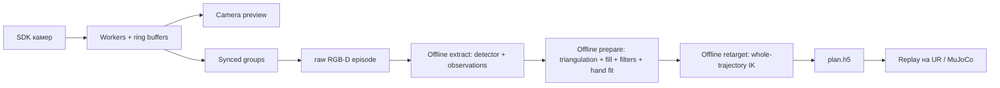

# Аудит ViKi перед online human retarget — 2026-10-13

Исторический срез **до реализации**. После этого аудита добавлена live-ветка;
её текущий [запуск](live_human_run.md) и [проверка](2026-10-13-live-validation.md)
описаны отдельно. Приведённые здесь component timings не являются замерами
нового полного контура.

Первый запрошенный режим: **камеры → движение человека → retarget → UR10e**.
Это живая имитация, для неё не нужен checkpoint Diffusion Policy. Срез кода:
`0fdbc02f8f68d82322d32fa9151097034593d30c` и локальные изменения UR10e replay /
MuJoCo предыдущего этапа. Аудит выполнен по реализации, девяти package README,
конфигурации, Docker и истории Git. Исследование не добавляет работающий live
контроллер: ниже описаны факты, измерения и границы будущей реализации.

Три параллельных направления исследования: camera/perception/filters,
online IK/UR executor, готовые policy runtime. Результат архитектуры:
[проект live human retarget](live_human_retarget_design.md).
Внешние решения и их совместимость:
[сравнение способов inference](live_inference_options.md).

## 1. Что уже online, что выполняется после записи



Live сейчас: SDK capture, camera preview, запись raw. В текущем
[`routes/skeleton.py`](../viki/server/routes/skeleton.py) остался только
`capture_base`; live hand estimation и WebSocket были удалены.
Исторический `SkeletonPipeline` удалён коммитом `544c1b3`: к моменту удаления
у него не было consumers после появления offline extract. Он делал detect /
mono lift отдельных камер без capture-time fusion, а не текущий V4 retarget.
Простое восстановление этого класса не возвращает полноценное online управление.

Конвейер состоит из durable файлов эпизода. FIFO worker
[`server/jobs.py`](../viki/server/jobs.py) подходит для offline jobs и команд
управления сессией; он не является исполнительным циклом робота.

## 2. Зависимости и границы окружений

| Слой | Фактические зависимости / особенности |
|---|---|
| Core | Python ≥3.10; NumPy ≥1.26; SciPy ≥1.11; OpenCV headless ≥4.9; h5py ≥3.10 |
| Камеры | `pyrealsense2>=2.58`, native librealsense; Azure Kinect `libk4a1.4.1` через ctypes, depth engine и factory calibration blobs |
| Hand detector V4 | `mediapipe>=0.10.35`, cached `.task`; постоянный VIDEO instance на camera stream |
| Альтернативный detector | RTMPose-Hand через rtmlib / ONNX Runtime; Docker ставит ORT GPU и CUDA runtime wheels; fallback на CPU проверяется backend-ом |
| IK | `pin>=3.5`, `pin-pink>=4.0`, QPSolvers, OSQP, quadprog; robot_descriptions / xacrodoc; URDF и collision geometry кешируются в `models/` |
| UR | `ur-rtde>=1.6.3,<2`, host networking, Dashboard/RTDE; текущий driver — только arm-only |
| UI | FastAPI/Uvicorn, plain JS, Three.js для WebGL viewer; UI не должен владеть servo loop |
| MuJoCo | optional `mujoco>=3.3,<4`; отдельный CPU `preview` image |
| SAM/object branch | отдельный SAM2 image, pinned source commit, Torch 2.8 / CUDA 12.8; для первого arm-only live не требуется |
| Future policy | LeRobot / robomimic / PyTorch — отдельный слой; современный LeRobot требует другого Python окружения, подробности в сравнении решений |

Источник требований: [`pyproject.toml`](../pyproject.toml),
[`docker/Dockerfile`](../docker/Dockerfile),
[`Dockerfile.ur`](../docker/Dockerfile.ur),
[`docker-compose.yml`](../docker-compose.yml).
Нижние границы пакетов не являются lock-файлом проверенного online deployment.
Версии рабочих SDK, модели, solver и calibration hash надо фиксировать в сессии.
Загрузка весов, URDF и warm-up должны завершаться до активации live.

Текущий `ur`/`preview` image Python 3.10 не содержит всей camera/perception
среды. Для новой live camera service нужны SDK; менять её на CPU replay image
нельзя. Для первого live нет причины включать SAM2 и policy weights.

## 3. Фактическая последовательность обработки V4

### Получение и синхронизация

1. Каждый camera worker кладёт кадры в ring buffer (default 12) и ставит
   `host_timestamp_us=monotonic_ns()/1000` после SDK delivery. Это время
   получения, а не измеренная экспозиция. Native camera timestamp хранится отдельно.
2. `MultiCameraSync` выбирает кадры около текущего host tick. Для verified
   wired Kinect pair subordinate привязывается к native master timestamp с
   оценённым постоянным offset и допуском 500 µs; USB arrival jitter не заменяет
   эту проверку. Общий freshness window зависит от sync_fps.
3. Recorder отправляет группы writer thread через queue до `fps*3` элементов.
   При переполнении он отбрасывает группы. RGB — constant-fps MP4, depth — NPY
   по accepted group index. JSON timestamps сохраняют реальный timing evidence.

См. [`manager.py:44`](../viki/cameras/manager.py#L44),
[`sync.py:111`](../viki/cameras/sync.py#L111),
[`record.py:80`](../viki/cameras/record.py#L80).
`get_synced_frame()` сейчас не проверяет, что native frame ещё не был consumed:
для live нужны deduplication и sequence. Writer queue может иметь backlog;
для управления нужна отдельная latest-value очередь с возрастом наблюдений.

### Detector и две геометрические ветки

4. Named `stable-fused-hand-v4` принудительно выбирает MediaPipe, а не
   конфигурационный `POSE_BACKEND=rtmpose-m-hand5`. Профиль владеет алгоритмическими
   параметрами; в нём все 21 landmark, min confidence 0.5, VIDEO, flip=False.
   `extract_episode()` целиком декодирует одну камеру, затем следующую.
5. BGR → RGB; depth uint16 mm → float32 m, нули → NaN. Color→depth projector
   строится из cached sensor calibration. Identity fallback при отсутствии
   factory geometry возможен в offline extract; в live для unaligned Kinect
   это нельзя молча принимать.
6. MediaPipe wrapper поддерживает IMAGE/VIDEO с синхронным `detect_for_video`.
   Он не оборачивает LIVE_STREAM callbacks. `num_hands=1`; аргумент left/right
   не выбирает одну из двух видимых рук. Accepted score=1.0, handedness score
   не считается качеством landmarks; native presence/tracking gates остаются.
7. После detection сохраняются две разные ветки. Основная — 2-D observations:
   UV, score, median depth, validity и ROI std. Радиус V4 — 38 mrad, переведённый
   в pixels конкретного depth sensor. Valid depth: центр валиден или >25% ROI
   имеет чтение. Здесь background subtraction не применяется.
8. Legacy `rec.npz` содержит mono lift: robust palm depth, shape из UV и
   model-relative z, camera→rig transform и веса visibility·sensor·range⁻²·incidence.
   Эта shape не является 21 независимо измеренными metric points. Mono lift
   с background plate может сначала выбрать foreground depth; fallback —
   все valid ROI samples. В штатном extract `discard_outliers=False`.

См. [`profiles.py:45`](../viki/perception/profiles.py#L45),
[`run.py:88`](../viki/perception/run.py#L88),
[`extract.py:142`](../viki/perception/extract.py#L142),
[`mediapipe.py:63`](../viki/perception/backends/mediapipe.py#L63),
[`observations.py:55`](../viki/perception/observations.py#L55),
[`geometry.py:123`](../viki/perception/geometry.py#L123).

### Triangulation и prepare

9. На named V4 основной fused source — triangulation сырых observations,
   сгруппированных по accepted raw group index. Per-camera interpolation legacy
   `rec` остаётся диагностическим промежуточным артефактом.
10. Для каждого landmark: ≥2 cameras, finite UV, score≥0.3 → OpenCV undistort
    → DLT всех camera pairs → positive depth / ray angle≥5° → inlier selection
    по angular reprojection gate 25 mrad.
11. Лучший candidate уточняется SciPy least_squares / soft_l1, max_nfev=60:
    angular reprojection и soft depth residual. Depth weight уменьшается со
    spread; есть skin→joint offsets. Quality основана на views/reprojection/ray
    angle; это не измеренная covariance. Нет ≥2 views → gap, без mono fallback.
12. Optional time alignment выключен в default V4. При включении используются
    соседние UV samples, иногда будущие; depth остаётся от исходного кадра.
13. Fused XYZ попадают на time grid, затем coordinate-wise linear gap fill
    **без ограничения длины gap** и edge hold.
14. Per-landmark centered Savitzky–Golay, polyorder 2, окно nominal 233 ms.
    Оно пересчитывается по median dt эпизода: примерно 7 frames при 30 Hz / 5
    при 15 Hz; lookahead около 100 / 133 ms соответственно.
15. Palm frame получается из wrist/index/middle/pinky MCP. Missing quartet
    допускает fallback centroid + identity rotation, который сам помечается
    valid. Дополнительная stability mask использует episode median geometry,
    angle/length gates и отвергает обе стороны jump >60°.
16. Landmark confidence нормируется на maximum всего эпизода. Palm omega —
    mean четырёх anchors; default V4 не требует, чтобы все четыре были direct
    observations. Низкая uncertainty здесь не доказана.
17. Gripper mapping — thumb/index gap относительно palm length; normalized
    opening и causal EMA. Missing measurement удерживает previous с quality0.

См. [`triangulate.py:191`](../viki/perception/triangulate.py#L191),
[`triangulate.py:304`](../viki/perception/triangulate.py#L304),
[`prepare/run.py:460`](../viki/prepare/run.py#L460),
[`prepare/run.py:153`](../viki/prepare/run.py#L153),
[`dsp.py:59`](../viki/dsp.py#L59), [`gripper.py:129`](../viki/gripper.py#L129).

### Articulated fit, retarget, replay

18. V4 запускает articulated postprocess: clean CLN сначала защищается hash,
    потом добавляются `hand_fit_*`. Геометрия пальцев калибруется по выбранным
    open-hand frames всего эпизода. Есть gap interpolation, sparse batch solve
    по windows 120 / overlap 30, temporal terms и качество кандидата.
    Config `PERCEPTION_HAND_POSE_SOURCE=hand_fit` влияет на downstream pose.
19. Retarget переносит pose из rig через world anchor в calibration и robot
    base, учитывает hand→EE mapping, adapter и gripper TCP. Позиции/ориентации
    с gaps также интерполируются с использованием последующих кадров.
20. Whole-trajectory QP одновременно решает q₀…qₜ с posture, data, velocity,
    acceleration regularization, position/velocity limits, floor/self-collision.
    Добавляется approach из home; сохраняется `plan.h5`, joints — физические rad.
21. Replay заранее пересэмплирует полный approach+demo и подаёт servoJ.
    Измеренные arm states, commands и timestamps сохраняются. Это готовый
    путь исполнения плана, но не интерфейс новых live targets.

См. [`articulated.py`](../viki/perception/articulated.py),
[`hand_fit.py:410`](../viki/perception/hand_fit.py#L410),
[`retarget/run.py:568`](../viki/retarget/run.py#L568),
[`solver.py:521`](../viki/retarget/solver.py#L521),
[`replay/ur.py:170`](../viki/replay/ur.py#L170).
Temporal terms hand fitter используют differences per frame без dt; только
инвариантность SG окна не делает весь temporal estimator частотно-инвариантным.

## 4. Что требуется заменить для причинной обработки

| Offline элемент | Online замена |
|---|---|
| unlimited interpolation с будущим endpoint | short-lived hold/predict, validity/observed masks, TTL; held state не новая measurement |
| centered SG | causal One Euro / stateful low-pass; SO(3) orientation filtering |
| episode maximum confidence | фиксированная absolute calibration, frozen before run |
| episode median palm / selected future open-hand frames | отдельная session calibration, затем frozen dimensions |
| полный articulated trajectory fit | сначала direct palm/7-anchor arm tracking; потом отдельный causal budgeted hand fit |
| edit обеих сторон orientation jump | invalidate newest sample, consumed history immutable |
| batch IK на весь эпизод | incremental velocity QP с current q, явным dt и boundary q/qd |
| full-array replay | persistent executor, bounded fresh targets, command expiration |

`solve_sequential_baseline()` **не готовая online замена**: он передаёт T=1
в batch solver; матрица разностей пустая, и velocity constraints перехода от
previous q не создаются. Потом SG опять использует будущие точки.
См. [`solver.py:648`](../viki/retarget/solver.py#L648),
[`solver.py:889`](../viki/retarget/solver.py#L889).
Ограничение max_step одной итерации оптимизатора не заменяет rad/s bound.

## 5. Геометрия, hardware и данные следующей политики

- Camera host time, native device time и RTDE controller time — разные данные.
  Нужны robot sample receive monotonic stamp, sequence и связь commands с
  исходной camera group. Новый host timestamp не должен освежать held кадр.
- Rig→calibration anchor и robot base registration должны иметь явные hashes /
  frame names. Старый label `robot_base` на frozen CLN иногда означает rig;
  автоматическое переименование не является калибровкой.
- Calibration bundle применяет exact SDK Kinect color rays; текущий hand
  triangulation использует OpenCV K/dist, причём legacy Kinect intrinsics имеют
  zero-distortion default. Эти optical models различаются. Для новой live ветки
  надо использовать согласованные rays и отдельно измерить влияние на task volume.
  См. [`bundle.py:79`](../viki/calibration/bundle.py#L79),
  [`triangulate.py:88`](../viki/perception/triangulate.py#L88).
- Offline virtual gripper pad midpoint и active UR TCP различаются. Для
  arm-only live tool definition должен быть явным; будущая humanoid hand имеет
  собственную named vector command/state, не универсальное scalar opening.
- Floor и self-collision модели не содержат реального стола/стойки/кабелей.
  Online motor limits не доказывают отсутствие collision с окружением.
- Текущий LeRobot exporter создаёт action из next attained state и ссылается
  на human raw video, без robot-execution camera synchronization. Это не готовый
  observation→command dataset. Для будущей политики нужна запись robot rollout.
  Human+robot footage во время мимикрии также требует продуманного camera view,
  если политика позже исполняется без человека в кадре.
  См. [`export/run.py:91`](../viki/export/run.py#L91).

## 6. Измеренные компоненты и причина низкой плавности MuJoCo

В `preview` задано `LIBGL_ALWAYS_SOFTWARE=1`; сохранённое MP4 имеет 20 fps,
а просмотр выбранной траектории запускался 10×. Частота визуализации,
физических шагов и robot servo loop независимы.

13 октября измерен отдельный headless EGL render статичной UR10e сцены после
3 warm-up frames, 30 samples на размер. `renderer.update_scene + render`:

| Размер | Median, ms | p95, ms | Throughput, frames/s |
|---|---:|---:|---:|
| 640×480 | 146.48 | 176.81 | 6.75 |
| 960×720 | 194.17 | 270.83 | 5.05 |

Это **не измеренный GUI fps** и не latency UR. Но результат подтверждает,
что software render дорогой. Для online viewer нужна независимая частота /
процесс; GPU graphics можно настраивать отдельно от camera SDK image.
Данные: `data/mujoco_render_profile_2026-10-13.json`.
Физический план не менялся; cached model revision из предыдущего этапа сохранён.

На первых 80 paired groups выбранного raw эпизода отдельно измерена V4
frame-local triangulation по уже записанным 2-D observations. I/O, detector,
depth sampling, filters, IK, robot и rendering **исключены**:

| Landmarks | Median, ms | p95, ms | p99, ms | Max, ms |
|---|---:|---:|---:|---:|
| все 21 | 19.39 | 40.98 | 68.99 | 74.47 |
| arm anchors `[0,1,4,5,8,9,17]` | 5.92 | 6.35 | 7.77 | 11.90 |

На этом фрагменте все выбранные landmarks получили решение. Это не accuracy
проверка и не end-to-end online fps. Порядок измерений фиксирован: 21, затем7;
один эпизод не заменяет latency-under-load протокол. Результат поддерживает
первый arm-only путь на 7 anchors с дальнейшей записью всех detector landmarks.
Данные: `data/live_geometry_profile_2026-10-13.json`.

Для воспроизводимого detector/sampling/triangulation profiling добавлен
[`benchmark_live_perception.py`](../scripts/benchmark_live_perception.py).
Он использует записанные RGB 1920×1080 / depth640×576, persistent VIDEO
detector на камеру, strict cached factory SDK projectors, без downscaling,
скачивания моделей или записи в episode. 10 warmup и50 measured paired groups;
ветки21/7 получают одни detections, порядок geometry branches чередуется.

| VIDEO component на пару камер | Median, ms | p95, ms |
|---|---:|---:|
| RGB/depth preparation | 1.68 | 3.08 |
| Две детекции | 21.99 | 30.59 |
| Depth sampling21 | 1.93 | 2.71 |
| Triangulation21 | 16.26 | 17.35 |
| **Total21** | **41.82** | **52.61** |
| Depth sampling7 | 0.81 | 1.70 |
| Triangulation7 | 5.90 | 8.58 |
| **Total arm7** | **31.28** | **40.52** |

Total p95 посчитан по per-group суммам, не суммой stage quantiles.
All anchors solved50/50 в обеих ветках. Decode/read, live SDK/USB/sync, filters,
IK, servo и GUI исключены. Init/import и warmup записаны отдельно.
Между прогонами arm7 p95≈40–46ms; worst-case deadline это не доказывает.
В записи requested NFOV_UNBINNED30fps; median sync interval33.409ms.
Текущий delivered live camera rate этим экспериментом не измерялся.

IMAGE mode отдельно дал полный двухкамерный triangulation только9/50 groups:
неполная coverage снижает объём refinement, поэтому пониженный total не
считать ускорением. Для первого runtime выбран persistent VIDEO.
Результаты: `data/live_perception_benchmark_2026-10-13.json` и
`data/live_perception_image_benchmark_2026-10-13.json`.
Среда: Python3.10.12, MediaPipe0.10.35, NumPy2.2.6, OpenCV4.12.0.88,
SciPy1.15.3, K4A1.4.1. JSON сохраняет inputs/model/source hashes и per-frame
timings. Script/source SHA:
`631b26210b9600d09a9a56875f16cb115d72d6505874a2e4281b093fc79584da`.

В имеющемся тестовом image запускать:

```bash
docker compose -f docker-compose.yml -f /tmp/viki-ur10e-fast-compose.yaml \
  run --rm --entrypoint python3 test scripts/benchmark_live_perception.py \
  data/datasets/40mm-pnp/2026-10-06_11-15-00 \
  --out data/live_perception_benchmark_2026-10-13.json
```

Override в `/tmp` — локальная среда предыдущего этапа, не переносимый файл
репозитория. После сборки стандартного image тот же script запускается
`docker compose run --rm --entrypoint python3 test ...`.
Full pytest suite через Compose после новых файлов: **436 passed,7 skipped**.
Production stages, frozen profiles и аппаратные настройки в этом исследовании
не менялись; SDK/camera streams и RTDE Control не запускались.

## 7. Документы, которые расходятся с реализацией

Аудит не меняет frozen profiles или camera lifecycle. Найденные расхождения:

| Документ | Реализация |
|---|---|
| perception README ссылается на SkeletonPipeline / pipeline.py | этот класс удалён, live hand service отсутствует |
| prepare README говорит default V2 | `DEFAULT_PERCEPTION_PROFILE=stable-fused-hand-v4` |
| prepare README помечает range/incidence weights stub | mono weights реализованы; основная named ветка использует triangulation quality |
| backend README помечает RTMPose stub | RTMPose backend реализован; HaMeR/YOLO ещё stubs |
| camera README / AGENTS описывают stop sleep2s | текущий `KinectBackend.stop()` не содержит sleep; lifecycle без аппаратной проверки не менять |
| исторический docs/math.md описывает V2/V3 как default | для нового live решения источник истины — текущие код/profile manifests |

## 8. Итог выбора

Короткий путь для текущего запроса: переиспользовать capture, persistent
detectors, frame geometry и UR checks, а новые causal preparation и incremental
IK соединить с независимым RTDE executor. Визуализация и writer работают рядом,
без блокировки управления. Для первого прохода нужны recorded-frame simulation,
live MuJoCo, затем read-only robot telemetry и ограниченный physical trial.

Автономная Diffusion Policy позже становится другим action producer этого
runtime. Live human tracking само по себе не создаёт обученную политику.
