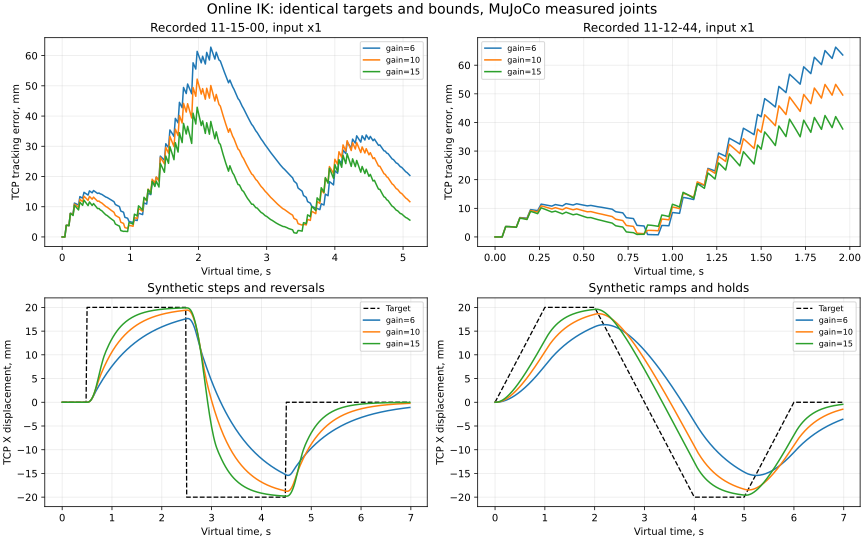

# Онлайн-IK: первый эксперимент с настройками слежения

Дата: 2026-10-19. Выполнена первая часть
[плана улучшений](live_improvement_todo.md): сравнение position gain и
регуляризации на одинаковых входах в MuJoCo. Физический UR не подключался.

## Что изменено в реализации

Числа objective вынесены из `OnlineRetargeter.step` в `contracts.LiveIKTuning`.
Можно явно передать `OnlineRetargeter(options, tuning=...)`; live-исполнитель
без override читает новые `LIVE_IK_*` ключи конфигурации. Применённые параметры
попадают в manifest модели и durable executor report.

В `replay.benchmark_live_ik` добавлено воспроизводимое сравнение. Оно создаёт
только MuJoCo backend и online retargeter; камеры, live supervisor и RTDE owner
не создаются. CLI — `scripts/benchmark_live_ik.py`.

Штатные defaults сохранены: position gain 6 s⁻¹, orientation gain 4 s⁻¹,
damping 1e-4, acceleration weight 1e-3. Gain 15 — экспериментальный кандидат.
Фильтрация perception в этом сравнении не менялась. Feed-forward ещё не добавлен.

## Протокол

1. Из закрытого MuJoCo execution log взять первый непрерывный участок
   `state == active && command_accepted`. Не выбирать лучший участок и не
   склеивать интервалы через потерю наблюдения.
2. Зафиксировать target position, времена доступности исполнителю и исходные
   source timestamps. На общей сетке 50 Гц использовать только последний уже
   доступный target, без интерполяции и без продления TTL.
3. Каждый вариант начать из одинаковых измеренных q первого отсчёта.
   Исходная рука должна быть неподвижна; симулятор начинает с нулевой скорости.
   Зафиксированная ориентация TCP удерживается, ориентация человека не повторяется.
4. Сохранить прежние ограничения: velocity 0.25 rad/s, acceleration 0.5 rad/s²,
   tracking tolerance, joint limits, floor и self-collision clearance 0.02 m.
   Сверить URDF SHA и доступные поля исходной MuJoCo identity.
5. Сравнить gains 6 / 10 / 15 s⁻¹. На основном эпизоде дополнительно проверить
   damping 1e-5 / 1e-3 и acceleration weight 0 / 1e-4 / 1e-2: всего 18 вариантов.
6. Измерять расстояние между текущей целью и FK TCP по **измеренным** суставам
   до команды текущего цикла. Сохранять полные traces, насыщения, solver timings,
   исходные hashes и проверки ограничений. Отвергнутый вариант не считать успешным.

Это виртуальная номинальная шкала исполнения. Она позволяет изолировать
objective IK от повторного распознавания и scheduling; сохранённое solver time
не доказывает соблюдения live deadline на нагруженном хосте.

## Результаты на записях

| Вход / первый непрерывный участок | Gain | Mean, мм | RMSE, мм | P95, мм | Max, мм |
|---|---:|---:|---:|---:|---:|
| `11-15-00`, input ×1, 5.10 s | 6 | 26.60 | 30.98 | 58.55 | 62.79 |
| тот же вход | 10 | 20.45 | 24.25 | 46.81 | 52.22 |
| тот же вход | 15 | **15.48** | **18.77** | **36.30** | **42.90** |
| `11-15-00`, input ×0.5, 3.44 s | 6 | 12.74 | 14.15 | 21.76 | 22.72 |
| тот же вход | 10 | 9.55 | 10.88 | 17.01 | 18.17 |
| тот же вход | 15 | **7.32** | **8.44** | **13.26** | **14.78** |
| отдельный `11-12-44`, input ×1, 1.96 s | 6 | 23.52 | 31.52 | 62.86 | 66.31 |
| тот же вход | 10 | 20.44 | 26.78 | 50.42 | 53.30 |
| тот же вход | 15 | **17.30** | **22.19** | **40.38** | **42.43** |

На основном входе mean уменьшился на 41.8%, на отдельной записи — на 26.5%.
В исходном live log основной mean равен 26.70 мм по 255 samples; здесь 26.60 мм
по 256 samples из-за повторной причинной выборки на номинальной сетке.
Это разные выборки, поэтому прежний результат не заменяется задним числом.



Верхние графики — полная позиционная ошибка, нижние — X-компонента смещения
TCP и цели в synthetic scenarios. Все кривые построены по measured MuJoCo q.

Основная session: `27daacc0ad084015b4bb409853ec7fda`, slow session:
`9b53a009a7004a8794d755dd029c3636`, дополнительная:
`5ed3050ea7814e17aa8ab251e706421e`. Последняя получена свежим причинным
инференсом из `2026-10-06_11-12-44`. После 99 active samples наблюдение стало
невалидным (`invalid_human_position`), последовали braking и unbound.
Автовозобновления не было. Поэтому это короткая дополнительная проверка,
а не подтверждение следования на всём эпизоде. Slow session также оценивается
только до первой потери binding.

## Остановки и смены направления

Добавлены отдельные synthetic scenarios: смещение robot-base X на ±20 мм,
step либо linear ramp, удержания и развороты; 350 samples / 6.98 s каждый.
Каждый tick получает явно свежий synthetic target; perception в этих опытах нет.

| Сценарий | Gain | Mean всего, мм | P95 всего, мм | Max всего, мм | Mean на удержаниях, мм |
|---|---:|---:|---:|---:|---:|
| Step | 6 | 9.45 | 28.85 | 37.66 | 4.90 |
| Step | 10 | 7.28 | 27.08 | 39.42 | 2.07 |
| Step | 15 | 5.63 | 25.67 | **39.90** | 0.66 |
| Ramp | 6 | 7.91 | 14.95 | 15.94 | 5.79 |
| Ramp | 10 | 5.75 | 10.47 | 10.75 | 2.55 |
| Ramp | 15 | 4.11 | 7.29 | 7.34 | 0.95 |

Holding windows начинаются через 1 s после step или 0.5 s после окончания
ramp. Это мера остаточного отставания/сходимости, не sensor jitter. В step
сценарии max при gain 15 немного **хуже** baseline: улучшились не все метрики.
Ошибка в момент скачка цели сама по себе не отделяет overshoot от величины
нового перемещения. Нужны дальнейшие движения и анализ переходных процессов.

## Что показал эксперимент

- На этих входах усиление позиционной коррекции влияет существенно сильнее,
  чем проверенные изменения damping/acceleration regularization. Например,
  при gain 15 mean варьирует примерно 15.46–15.50 мм; выигрыш относительно
  стандартных weights составляет сотые миллиметра и не обосновывает их смену.
- На основном входе доля циклов, где хотя бы один сустав достигает границы
  ускорения, выросла с 51.6% до 75.0%. Peak command speed вырос с 0.101 до
  0.154 rad/s при сохранённом лимите 0.25 rad/s. Усиление не устраняет
  необходимость торможения и разворота в пределах прежних ограничений.
- Эффект на втором эпизоде есть, но доступный непрерывный участок короткий.
  Нужны более длинные записи, шум неподвижной кисти и проверка 6-D режима.
- Следующий шаг по пункту 1 — ограниченная feed-forward скорость цели,
  причинно оценённая по новым observations, и сравнение с этими же baselines.
  Нельзя продлевать TTL или продолжать движение по предсказанию при потере руки.

Не менялись активные настройки на физическом роботе, online filter profile,
frozen offline profiles и защищённые baseline artifacts. Измерения относятся
к model-space TCP tracking; абсолютная accuracy кисти и физического UR неизвестна.

## Повторение

```bash
docker compose run --rm --entrypoint python live scripts/benchmark_live_ik.py \
  data/live_sessions/27daacc0ad084015b4bb409853ec7fda \
  --out data/live_ik_experiments/<new-name> --regularization

docker compose run --rm --entrypoint python live scripts/benchmark_live_ik.py \
  data/live_sessions/27daacc0ad084015b4bb409853ec7fda \
  --out data/live_ik_experiments/<new-step-name> --scenario step
```

Полные локальные результаты находятся в `data/live_ik_experiments/2026-10-19-final-*`.
Сырые записи и rig-specific config не публикуются. Сводка чисел и hashes:
[`experiments/online_ik_2026-10-19.json`](experiments/online_ik_2026-10-19.json).

Все 30 финальных вариантов завершены без отклонения ограничений, включая
проверку измеренной суставной скорости с тем же допуском, что и live executor.
Полный Docker suite: **549 passed, 7 skipped**. Дополнительные проверки
покрывают причинную выборку целей, TTL, запрет hardware inputs, несмыкание
потерянных binding и сохранение failed/partial traces.
