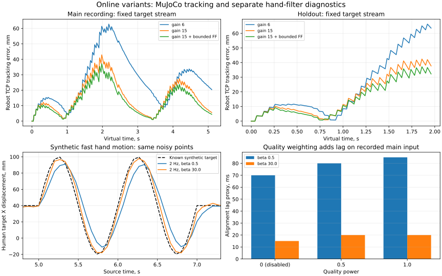

# Остальные варианты: feed-forward, фильтры, кости и восстановление

Дата: 2026-10-19. Продолжение [первого эксперимента IK](2026-10-19-online-ik-experiment.md).
Физический UR и живые камеры не использовались. Существующие frozen profiles
и защищённые baseline artifacts не менялись.



## Feed-forward: результат на одинаковых целях

Добавлена причинная оценка скорости цели `CausalTargetVelocity`. Разности
считаются по **разным source timestamps**, а не на каждом servo tick.
Вектор сглаживается, ограничивается по норме и затухает при отсутствии новых
наблюдений. При bind/clutch/loss история сбрасывается; TTL исходного наблюдения
не продлевается. В QP добавляется `feedforward_gain * target_velocity`.
Ограничения суставов, скорости, ускорения, floor/collision и tracking admission
сохранены. Реально использованная составляющая пишется в execution log.

Выполнены 12 первоначальных сравнений, 28 вариантов сетки cutoff/cap/hold
при gain 15 и 30 валидационных прогонов: всего 70 завершённых симуляций.
Валидация использует тот же протокол первого непрерывного active segment,
причинную выборку и frozen target inputs, что и предыдущий эксперимент.

| Вход | Gain 6, mean мм | Gain 15, mean мм | Gain 15 + FF 1, mean мм | P95 с FF, мм |
|---|---:|---:|---:|---:|
| `11-15-00`, ×1, 5.10 s | 26.60 | 15.48 | **13.02** | 30.16 |
| тот же эпизод, ×0.5, 3.44 s | 12.74 | 7.32 | **6.11** | 11.09 |
| `11-12-44`, ×1, 1.96 s | 23.52 | 17.30 | **14.93** | 35.01 |
| Synthetic ramp | 7.91 | 4.11 | **3.37** | 5.98 |
| Synthetic step | 9.45 | 5.63 | **5.63** | — |

Здесь FF 1: cutoff 5 Hz, cap 0.1 m/s robot-space, hold 0.12 s. Затухание
начинается после половины hold; это возраст с момента появления новой оценки
у потребителя. Независимая source TTL по-прежнему ограничивает валидность.
На holdout и slow по-прежнему оценивается только участок до первой потери
binding; неполные эпизоды не представлены как полноценное непрерывное следование.

Самый низкий main mean в сетке — 12.86 мм при cap 0.15 m/s / hold 0.2 s.
Разница со стандартным FF-кандидатом 0.16 мм не стала основанием увеличивать
лимит скорости оценки и длительность её удержания. На step добавление FF
почти не помогает: единичный скачок не задаёт продолжающуюся скорость цели.

## One Euro: одинаковая геометрия до сглаживания

В estimator добавлен opt-in `capture_raw=True`. Он сохраняет текущие
триангулированные `raw_points` **до** сглаживания. Выполнены два новых прохода
RGB-D → geometry при реальном host clock, input ×1, perception 15 Hz:

- main `11-15-00`: 89 estimates / 78 valid positions;
- holdout `11-12-44`: 87 / 77.

После этого MediaPipe не пересчитывался для вариантов фильтра. На каждой записи
сравнены 5 cutoff × 5 beta × 3 quality powers = 75 вариантов; отдельно 25
вариантов на фиксированной synthetic motion/noise sequence. Baseline 2 Hz / 0.5
точно воспроизвёл сохранённые live filtered points (max difference 0).
На потере валидной позиции filter state сбрасывается, как в runtime.

| Настройка | Main lag proxy, ms | Holdout lag proxy, ms | Synthetic moving RMSE, мм | Synthetic stationary RMSE, мм |
|---|---:|---:|---:|---:|
| cutoff 2, beta 0.5 | 70 | 70 | 8.75 | 1.81 |
| cutoff 2, beta 30 | **15** | **15** | **3.97** | 1.99 |

Lag proxy — подбор сдвига 0–250 ms с шагом 5 ms относительно прошлых **сырых
оценок**, а не camera-to-actuator latency или разметки движения человека.
Интерполяция применяется только при вычислении этой офлайн-диагностики,
не при фильтрации или управлении. На настоящих записях ground truth нет.

Synthetic: 15 Hz, seed 20261019, независимый шум σ=2 mm + общий σ=1 mm,
удержания, медленное движение, быстрый синус и потеря наблюдений. Только здесь
известно истинное положение. Beta 30 уменьшает задержку при движении ценой
примерно 10% большего stationary RMSE. Другие режимы шума и реальные камеры
ещё могут изменить выбор; beta зависит от единиц (здесь метры и секунды).

## Качество наблюдений: простой вариант не принят

Экспериментально добавлена формула
`alpha *= clip(geometric_quality, 0.1, 1)^quality_power`.
Это явный opt-in parameter, не оценка калиброванной covariance.

При cutoff 2 / beta 0.5 powers 0 / 0.5 / 1 увеличили lag proxy на **обеих**
записях с 70 до 80 и 85 ms. При beta 30 на main это 15 / 20 / 20 ms.
Доказательства повышения абсолютной точности нет. Поэтому power оставлен 0.
Для более обоснованного веса требуется связь geometric residual с измеренным
шумом/ошибкой, а не предположение «низкое quality → всегда сильнее сгладить».

## Анатомия: диагностический прототип, не full hand fit

`scripts/benchmark_live_bones.py` калибрует 20 длин по первым десяти полным
валидным кадрам, затем покадрово проецирует только наблюдаемые точки на
фиксированные длины. Missing fingers не достраиваются. Коррекция более 15 mm
по любой точке отвергает кадр. Будущие frames не меняют calibration или prefix.

| Запись, beta | Готовых кадров | Принято | Отвергнуто | CV костей до, % | Среднее смещение pinch, мм |
|---|---:|---:|---:|---:|---:|
| Main, 0.5 | 65 | 61 | 4 | 6.43 | 4.16 |
| Main, 30 | 65 | 59 | 6 | 6.66 | 4.04 |
| Holdout, 0.5 | 65 | 57 | 8 | 5.85 | 3.31 |
| Holdout, 30 | 65 | 56 | 9 | 6.08 | 3.33 |

CV после проекции близок к нулю **по построению**, это не доказательство
правильности кисти. Метрики до/после берутся на одной принятой выборке;
отбраковки показаны отдельно. Сдвиг pinch и потеря части кадров — существенные
побочные эффекты. Не реализованы допустимые суставные углы, rigid palm,
confidence-weighted fitting и полная модель большого пальца. Этот прототип
не включён в live estimator; полноценная анатомическая стабилизация остаётся
открытой задачей, особенно для будущей гуманоидной руки.

## Восстановление ориентации

Добавлен экспериментальный `LIVE_ORIENTATION_RECOVERY`: старый anchor больше
не должен навсегда блокировать новый большой поворот. После aged reference,
большого angular jump или position loss требуются три свежих согласованных
ориентации. Missing palm прерывает подтверждение. Положение и ориентация имеют
раздельную валидность; никакой identity fallback не вводился.

В тестах проверены большой поворот 1.8 rad после пропуска, потеря позиции,
legacy поведение без опции, causality и ручной rebind после потери цели.
Проверка реального 6-D движения робота остаётся отдельной работой.

## Совмещённый runtime-прогон кандидата

Проверен [simulation candidate](live_simulation_candidate.json): gain 15,
FF 1 / 5 Hz / 0.1 m/s / 0.12 s, One Euro 2 Hz / beta 30, quality power 0,
orientation recovery включён. Input recorded ×1, perception 15 Hz, control
50 Hz; основной режим остаётся position following.

[Открыть Online review](http://localhost:8000/?online_session=c09e755b843a4a628fed2cfa8023599f#online-review).

Session `c09e755b843a4a628fed2cfa8023599f`: stopped / source_exhausted,
89 estimates / 78 valid, 255 active accepted samples. TCP error относительно
**своей новой filtered target**: mean 13.31 mm, RMSE 16.22 mm, p95 31.34 mm,
max 38.92 mm. Max applied FF 0.09968 m/s; maximum control compute 15.16 ms.
Artifact verifier прошёл, motion есть. В этом одном прогоне strict 20 ms
compute guard не сработал; это не hard real-time гарантия под любой нагрузкой.

С предыдущим live run нельзя напрямую приписать всю разницу одному параметру:
вход повторно распознавался, а фильтр менялся. Для сравнительных выводов служат
frozen-input эксперименты выше. Новые значения доказывают работоспособность
сочетания в runtime, а не физическую accuracy UR или hand pose.

Кандидат запускался через отдельный read-only config mount; активные настройки
стенда не заменялись. Штатные defaults: gain 6, FF 0, One Euro 2 / 0.5,
quality power 0, orientation recovery off. Явно нестандартный фильтр/восстановление
помечается профилем `live-human-sdk-rays-causal-tunable-v2` и параметрами manifest.
JSON кандидата содержит частичный overlay алгоритмических ключей; для запуска
он накладывается на копию полной конфигурации с её путями и SDK-настройками.

## Повторение и артефакты

```bash
docker compose run --rm --entrypoint python live scripts/benchmark_live_ik.py \
  data/live_sessions/<id> --out data/live_ik_experiments/<new-name> --feedforward

docker compose run --rm --entrypoint python live scripts/capture_live_filter_inputs.py \
  data/datasets/<dataset>/<episode> --out data/live_filter_experiments/<new-capture>

docker compose run --rm --entrypoint python live scripts/benchmark_live_filters.py \
  data/live_filter_experiments/<capture> --out data/live_filter_experiments/<new-name> --quality

docker compose run --rm --entrypoint python live scripts/benchmark_live_bones.py \
  data/live_filter_experiments/<capture> --out data/live_filter_experiments/<new-bones>
```

Raw inputs, complete traces и полные reports находятся в локальных
`data/live_ik_experiments/2026-10-19-*` и `data/live_filter_experiments/2026-10-19-*`.
[Публикуемая сводка и hashes](experiments/online_variants_2026-10-19.json)
не содержат записей или активной rig calibration.

Полный Docker suite после изменений: **566 passed, 7 skipped**. Проверены
source-cadence FF, cap/fade, сброс при loss/rebind, causal filter prefix,
raw capture, weight behavior, degenerate palm, повторное подтверждение
ориентации после missing palm/position loss и причинность bone calibration.
JSON/SVG и `git diff --check` также проверены.
